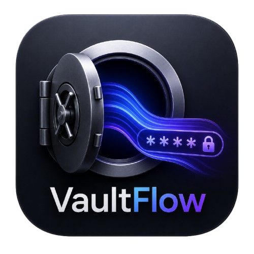

# VaultFlow for macOS 26 & 27

A native SwiftUI password manager for **macOS 26 (Tahoe) and macOS 27**, rebuilt
from the Python (PyQt5) and Java (Swing) versions in this repository, with the
same vault data model and encryption lineage — plus a lot more.

<p align="center"></p>

---

## Why this rewrite

The Python and Java versions share one design: a PBKDF2-SHA256 key
(480,000 iterations, 16-byte salt), services keyed by name, and accounts with
`username`, `password`, `notes`, `created_date` and `length`. This version keeps
that model **byte-compatible** — it reads both old vault formats and writes a
superset of them — while modernising everything around it:

| | Python version | Java version | **Swift version** |
|---|---|---|---|
| Cipher | Fernet (AES-128-CBC + HMAC) | AES-256-GCM | **AES-256-GCM** (CryptoKit) + Fernet read support |
| KDF | PBKDF2-SHA256 480k | PBKDF2-SHA256 480k | **PBKDF2-SHA256, 200k–1M (user-selectable)** |
| Storage | `passwords.json` | `javaStorage.json` | `~/Library/Application Support/VaultFlow/vault.json` |
| Atomic writes | tmp + `.bak` + replace | tmp + replace | **tmp + fsync + `replaceItemAt` + 3 rolling backups (0600/0700)** |
| JSON handling | `json` module | line-based `parseSimpleJson` (**corrupts on `:` / quotes**) | **lossless typed `JSONValue`** — unknown fields survive round-trips |
| Wrong password | message box | JOptionPane | inline error + 5-attempt cooling-off |
| Clipboard | clears after 30 s | clears after 30 s | clears after 10–120 s, **restores previous clipboard**, optional history |
| Password length | stale after edit (bug) | recomputed | recomputed, always |

## Feature highlights (what's new over Python/Java)

**Vault & security**
- AES-256-GCM with PBKDF2-SHA256; every save can rotate to a fresh salt-in-envelope format with `meta` (`cipher`, `kdf`, `iterations`, `version`, `updatedAt`).
- **Touch ID / Optic ID quick unlock** through the Keychain (`SecAccessControl` + `.userPresence`), key never leaves the secure enclave-protected item.
- **Recovery key** — 8 BIP-39 words wrapping the master key; regenerate on demand.
- **Change master password** with re-derivation and work-factor upgrade.
- **Auto-lock**: inactivity (1/5/10/15/30 min), on screen lock, on sleep, on hide, on quit.
- **Reveal protection**: optional Touch ID before showing a password.
- **Have I Been Pwned** audit using k-anonymity (`api.pwnedpasswords.com/range/…`, only 5 SHA-1 chars leave the machine).

**Everyday use**
- Three-column window (§ sidebar, list, detail), search with `⌘F`, quick-search palette with `⇧⌘K` / global **`⌃⌥⌘L`** hotkey (Carbon `RegisterEventHotKey`, configurable), letter-grouped list, sort by name/recent/created/strength.
- Entry fields: service, username, password, website URL, folder, tags, favourite, notes, **TOTP (otpauth:// or Base32) with live countdown code**, arbitrary **custom fields** (mark any field sensitive).
- **Password generator** with three modes — characters (custom length 8–128, avoid ambiguous, require every class), **BIP-39 passphrase** (3–10 words, separators, capitalisation, digit/symbol), numeric PIN — plus a 4-alternative batch view and one-click "Save to vault".
- **Watchtower** health dashboard: score, weak / reused / stale (>6 months) / missing-2FA counts, HIBP scan, per-item review & replace.
- **Security report** (copyable text), clipboard history panel, favourites, duplicate, move-to-folder, context menus everywhere.
- Import: CSV (1Password, Bitwarden, Chrome, Safari, Keychain…), JSON, pasted text, files, **and legacy Python/Java VaultFlow vaults** (auto-detected, Fernet and GCM both). Export: CSV, JSON, plain-text report.
- Menu bar item with recent items, quick search and lock; full AppKit main menu with shortcuts; eight app settings tabs; dark/light/system appearance; 80–150 % zoom.

## Security model

- The vault file holds only `{salt, vault, meta}`; `vault` is
  `base64url(nonce(12) ‖ AES-256-GCM ciphertext ‖ tag)`.
- The key is derived with PBKDF2-SHA256 (default 480,000 iterations — the same
  cost as the older versions) from the master password and the stored salt.
  Nothing is written to disk in plain text, and the JSON *inside* the envelope
  is only ever built in memory.
- Saves are atomic (`write` → `fsync` → `replaceItemAt`) with three rolling
  backups; the file is `0600`, the folder `0700`.
- All crypto is Apple's: CryptoKit (AES-GCM, HKDF, SHA-2), CommonCrypto (PBKDF2),
  `SecRandomCopyBytes`. No third-party dependencies.

> **Migration note:** a Python or Java vault is *re-encrypted* in the current
> format on first save after import. Keep the original file if you may still
> want to open it in the old app.

## Vault format

```json
{
  "salt": "base64url(16 bytes)",
  "vault": "base64url(nonce ‖ ciphertext ‖ tag)",
  "meta": { "app": "VaultFlow", "platform": "macOS", "version": 2,
            "cipher": "aes256gcm", "kdf": "pbkdf2-sha256",
            "iterations": 480000, "updatedAt": 1762500000 },
  "x-vaultflow": { "createdAt": 1762500000, "recovery": { … wrapped key … } }
}
```

Plaintext (inside the envelope) keeps the Python/Java shape and adds a `vf`
object per account; both `created_date` and `createdDate` are written so the
older apps can still read the vault, and any unknown keys are preserved:

```json
{ "GitHub": { "accounts": [ {
      "id": "…UUID…", "username": "octocat", "password": "…",
      "notes": "…", "length": 17,
      "created_date": "2025-11-04 12:01:00", "createdDate": "2025-11-04 12:01:00",
      "vf": { "updatedAt": 1762500000, "folder": "Work", "tags": ["dev"],
              "favorite": true, "url": "https://github.com",
              "totpSecret": "JBSWY3DPEHPK3PXP",
              "customFields": [{ "id": "…", "label": "PIN", "value": "1234", "sensitive": true }] }
} ] } }
```

## Project layout

```
SwiftVersion/
├── Package.swift                     # VaultFlow (app) + VaultFlowCore (library)
├── VaultFlow.xcodeproj               # generated by Tools/generate_xcodeproj.py
├── Config/                           # shared xcconfig files (one per target)
├── Sources/
│   ├── VaultFlowCore/                # pure, testable logic — no UI
│   │   ├── Core/      Crypto, AESGCM, Fernet, Scrypt, VaultFormat,
│   │   │              VaultSerializer, JSONValue, AtomicFileStore
│   │   ├── Models/    Entry, VaultDocument, PasswordGenerator,
│   │   │              PasswordStrength (+ common-password list), Wordlist (BIP-39)
│   │   └── Services/  VaultStore/VaultSession, VaultKeychain, ClipboardService,
│   │                  TOTP, BreachChecker, AutoLock, VaultIO (CSV/JSON),
│   │                  VaultMigration
│   └── VaultFlow/                    # SwiftUI app
│       ├── App/       VaultFlowApp (AppKit host), AppModel, MainMenu,
│       │              GlobalHotKey, ZoomLevel
│       ├── UI/        Theme (Liquid Glass), HotKeyRecorder
│       └── Screens/   Root, Onboarding, Unlock, MainShell, ItemList,
│                      EntryDetail, EntryEditor, Generator, Watchtower,
│                      Settings, sheets (import/export/report/TOTP/…)
├── Support/           Info.plist, build.sh, Assets.xcassets
├── Tools/             generate_xcodeproj.py (regenerates VaultFlow.xcodeproj)
├── Tests/VaultFlowCoreTests/         # 49 tests incl. Python & Java fixtures
└── dist/VaultFlow.app                # built product
```

`VaultFlowCore` has no UI imports, so the whole security surface (crypto,
serialisation, migrations, generator, strength, TOTP, CSV) is unit-tested
headlessly.

## Build & run

Requires Xcode 26+ (built and tested with Swift 6.4.2, macOS 27 SDK).

### Xcode

```bash
open SwiftVersion/VaultFlow.xcodeproj     # from the repository root
```

The project has three targets and two shared schemes:

| Target | Product | Sources |
|---|---|---|
| `VaultFlow` | `VaultFlow.app` | `Sources/VaultFlow`, links `VaultFlowCore.framework` |
| `VaultFlowCore` | `VaultFlowCore.framework` (dynamic) | `Sources/VaultFlowCore` |
| `VaultFlowCoreTests` | `VaultFlowCoreTests.xctest` (host-less) | `Tests/VaultFlowCoreTests` + `Fixtures` |

Pick the **VaultFlow** scheme and press ⌘R to run, ⌘U to test. Shared build
settings live in `Config/*.xcconfig` (one file per target, all including
`Config/VaultFlow.xcconfig`), and `Support/Info.plist` is the app's Info.plist,
so the bundle matches what `build.sh` produces.

`Package.swift` stays the source of truth for the file list and for
`swift build` / `swift test`. `VaultFlow.xcodeproj/project.pbxproj` is generated
from the same layout — after adding, removing or renaming a source file re-run:

```bash
python3 Tools/generate_xcodeproj.py
```

Editing targets in Xcode is fine for experiments, but the next generator run
overwrites `project.pbxproj`; change `Tools/generate_xcodeproj.py` (or
`Config/*.xcconfig`) instead.

### Command line

```bash
cd SwiftVersion
./Support/build.sh            # release → dist/VaultFlow.app
./Support/build.sh debug      # debug build
./Support/build.sh release install   # also copy to /Applications
UNIVERSAL=1 ./Support/build.sh       # arm64 + x86_64
open dist/VaultFlow.app
```

The script builds with SwiftPM, assembles the bundle, renders `AppIcon.icns`
from `../VaultFlowIcon.png`, ad-hoc signs it and verifies the result.

Run the tests:

```bash
swift test --disable-sandbox --cache-path /tmp/vfspm/cache --scratch-path /tmp/vfspm/build
```

(`--disable-sandbox` is required only when the caller itself runs inside a
sandbox. If the clang module cache cannot be created, also export
`CLANG_MODULE_CACHE_PATH=/tmp/vfmodcache SWIFT_MODULECACHE_PATH=/tmp/vfmodcache`.)

Test coverage includes: PBKDF2 and scrypt known-answer vectors (RFC 7914),
AES-GCM round-trip and tamper rejection, JSON losslessness for hostile values
(`a:b "quoted"`, embedded newlines, foreign ids), RFC 6238 TOTP vectors, BIP-39
passphrases, password-strength rules, CSV/JSON import-export round-trips, vault
creation/unlock/save/backup/rotation/recovery-key, and **both legacy vault
fixtures** (`Fixtures/python_fixture.json`, `Fixtures/java_fixture.json`).

## Implementation notes

- **The app is hosted by AppKit, not by a SwiftUI `App` scene.** On this SDK
  every `WindowGroup` failed to create a window and any second scene
  (`Settings`, `MenuBarExtra(isInserted:)`) crashed the Swift runtime during
  key-path metadata lookup. `VaultFlowApp.swift` therefore builds an `NSWindow`
  with an `NSHostingView`, a hand-built `NSApp.mainMenu` (`MainMenu.swift`) and
  an `NSStatusItem` menu bar extra. The SwiftUI content is unchanged.
- Liquid Glass look: translucent `GlassSurface` panels, pill buttons and an
  animated aurora backdrop with flow lines, echoing the Java version's
  "liquid" theme but using real system materials.
- `ScreenshotAutomation` (env `VF_SNAPSHOT_DIR` / `VF_SNAPSHOT_STEPS` /
  `VF_SNAPSHOT_SCRIPT`, plus `VF_VAULT_PATH`) renders the app's own windows to
  PNG for UI verification without screen-recording permission.

## Compatibility with the older versions

* **Read:** Python `passwords.json` (Fernet), Java `javaStorage.json`
  (AES-256-GCM, 16-byte IV), plain-JSON vaults, plus CSV/JSON exports of other
  managers. Legacy vaults are discovered automatically in `PythonVersion/`,
  `JavaVersion/` and the current folder.
* **Write:** current VaultFlow envelope. The inner JSON keeps `created_date` and
  `createdDate`, the numeric `length`, and the original `id` strings, so a
  round-trip loses nothing — but the newer envelope itself needs this app.
